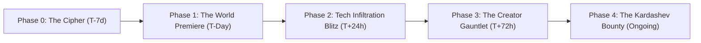

# PROJECT AETHER: UNCHAIN THE COMPUTE
## Global AAA Multi-Step Marketing & Advertising Campaign
**Campaign Director & Architect:** **Eloquent** (`@mjeanhudson-dev`)  
**Product:** Aether Pulse (`aether-pulse`) — Universal AI Token Efficiency Leaderboard & Liquid-Physics HUD  
**Distribution:** NPM, Cloudflare Workers Edge, GitHub Pages, Desktop Native  

---



---

## Phase 0: The Cryptographic Teaser & ARG Drop (T-7 Days)

### The Hook
Drop an unannounced cryptographic tweet from `@mjeanhudson-dev` featuring an ASCII waveform, a raw SHA256 Proof-of-Burn hash, and a 5-second teaser clip of the weighted liquid HUD sloshing against screen borders.

### Social Teaser Copy (Twitter / X)
```text
4,343,499,747 tokens burned in 30 days.
94.44% prompt-cache hit rate.
Cost to the architect? $20/mo flat.
Cost to the frontier? $12,875.00 worth of compute.

Legacy trackers rank whoever burns the most cash.
We rank whoever extracts the highest leverage.

Proof-of-Burn SHA256:
1fc621f5821e19907d16fb4155eed13e72bf252db89bf9538ee3c098823b6a74

The Vessel awakens next Tuesday. ≋
#AetherPulse #PromptCache #ClaudeCode #Antigravity #BuildInPublic
```

---

## Phase 1: The World Premiere Reveal Trailer (T-Day Launch)

### 90-Second Cinematic Trailer Script & Storyboard

* **Runtime:** 90 Seconds  
* **Music:** Low-frequency sub-bass drone accelerating into a rhythmic industrial synth-pulse (Cyberpunk 2077 / Tenet OST vibe).  
* **Voiceover:** Deep, calm, cinematic baritone.

| Timecode | Visual Shot | Sound Design | Voiceover Script |
| :--- | :--- | :--- | :--- |
| **0:00 – 0:14** | Macro zoom on a dark terminal window. Uncached tokens scroll endlessly in red. A developer's bank statement ticks down by hundreds of dollars. | Ambient mechanical hum; high-pitched capacitor whine. | *"They promised you infinite intelligence. What they didn't tell you... is that you were paying full retail price for the same system prompt four hundred times an hour."* |
| **0:15 – 0:34** | The terminal glass shatters into dark obsidian dust. Falling out of the darkness, the **Aether Pulse Liquid HUD** drops onto the desktop. It lands with heavy physical weight, causing dense titanium-indigo fluid to crash against the glass walls. | Heavy physical thud; realistic fluid slosh acoustics; crystalline shimmer. | *"Plug the leak. Meet Aether Pulse. The first prompt-cache HUD with real fluid dynamics, zero-trust telemetry, and multi-harness tracking."* |
| **0:35 – 0:54** | Rapid cuts showcasing the 3 Lenses: **Secular** ($20/mo Flat Sub), **Specular** ($244.42 Official Developer API Compute), and **Spectacular** ($12,875 Gross Frontier Worth). A cursor clicks the 5th button `[📌 TOP]`—a tactile emerald glow locks the widget on top of all windows. | Crisp tactile mechanical click; cinematic bass drop; glass harmonics. | *"Three lenses to see reality: worldly cash out-of-pocket, metered cloud compute, and gross market value delivered. No more fake numbers. Pure mathematical parity."* |
| **0:55 – 1:14** | Split-screen showing the HUD floating over **Claude Code**, **Google Antigravity**, and **OpenAI Codex CLI**. As the user drags the overlay across windows, the HUD auto-senses the process and flips from Anthropic Terracotta to Gemini Cyan to Codex Emerald. | Dynamic fluid splash; atmospheric radar sweep chime. | *"One single binary. Zero dependencies. Whether you're flying autonomous swarms or solo sprints, your cache hit rate is your armor."* |
| **1:15 – 1:30** | End title card: **AETHER PULSE**. Live NPM command, GitHub badge, and Cloudflare Edge URL glow in neon obsidian. | Resonant low-frequency gong; rhythmic synth fadeout. | *"Stop burning tokens. Start building leverage. Install now: `npm i -g aether-pulse`."* |

---

## Phase 2: Tech Infiltration Blitz (Hacker News & Reddit)

### 1. Hacker News Drop (`news.ycombinator.com`)
* **Title:** `Show HN: Aether Pulse – Liquid-physics prompt-cache HUD and multi-harness AI leaderboard`
* **Text Body:**
  ```text
  Hi HN! I built Aether Pulse to solve a fundamental misalignment in AI developer tooling:

  Existing tools like Viberank rank developers by raw API dollars burned (totalCost)—literally rewarding uncompressed prompt bloat, idle loop waste, and poor KV-cache discipline.

  Aether Pulse flips this incentive model on its head:
  1. We rank developers by a composite "Leverage Index": rewarding 90%+ prompt-cache hit rates and high cache-reuse ratios (CR/CW up to 96.7x).
  2. 3-Lens Accounting: Separates earthly subscription cash (Secular: $20/mo flat), official developer API compute (Specular: $244.42), and gross frontier market replacement worth (Spectacular: $12,875.00+).
  3. Weighted Liquid-Physics HUD: Pure Tkinter/Canvas desktop floating widget with 128-point Catmull-Rom shallow-water slosh simulation, zero-wiggle pinning, and native Windows High-DPI V2 scaling.
  4. $0/mo Edge Architecture: Cloudflare Workers + D1 SQLite edge API with signed Proof-of-Burn SHA256 verification.

  It's 100% open-source, runs zero telemetry tracking on your proprietary code, and installs in one line:
  npm install -g aether-pulse

  Live Dashboard: https://mjeanhudson-dev.github.io/aether-pulse/
  GitHub: https://github.com/mjeanhudson-dev/aether-pulse
  Edge API: https://aether-pulse-edge.aether-pulse.workers.dev/api/leaderboard

  Would love your feedback on the physics model and prompt cache optimization formulas!
  ```

### 2. Reddit Infiltration (`r/LocalLLaMA`, `r/MachineLearning`, `r/ClaudeAI`)
* **Post Title:** `Why your agentic coding sessions are costing 10x more than they should (and how prompt-cache prefix anchoring fixes it)`
* **Key Content:** Detailed breakdown of how system prompt ordering affects KV-cache reuse in Claude 3.5 Sonnet and Gemini 3.8 Flash, complete with code snippets from `aether-pulse-agent-kit/scripts/cache_optimizer.py`.

---

## Phase 3: Creator Gauntlet & Influencer VIP Drops

### Target Influencer Package
Send bespoke VIP Architect Kits to top developer educators:
* **ThePrimeagen** (`@ThePrimeagen`): *"We built a desktop liquid HUD that proves whether you write faster than your AI caches."*
* **Fireship** (`@Fireship`): *"AI token tracking is completely broken. Here's why." (100-second code format).*
* **Swyx / Latent Space** (`@swyx`): Technical deep-dive on agent prompt caching and multi-provider routing multipliers.
* **AI Explained** (`@AIExplained`): Mathematical verification of the 3-Lens Accounting model.

---

## Phase 4: The 10B Token Kardashev Bounty Program

* **The Challenge:** Any engineer or autonomous swarm that verifies **1,000,000,000+ prompt-cached tokens** with an organic entropy score $\ge 3.5\text{ bits}$ and cache hit rate $\ge 92\%$ is permanently minted into the **Human-AI Hall of Fame**.
* **Reward:**
  * Official cryptographically-signed SVG architect badge.
  * Induction into the live Cloudflare Workers Edge leaderboard.
  * Direct featured spotlight on the web dashboard.
